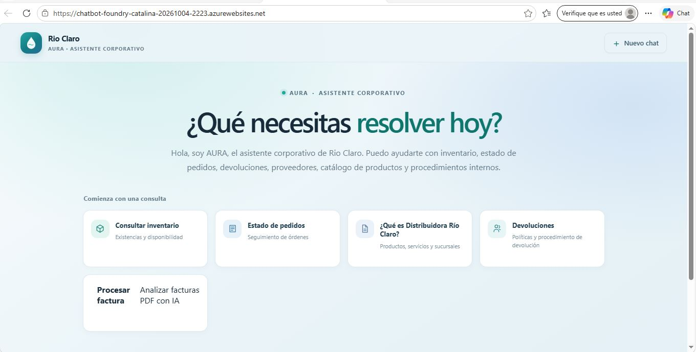
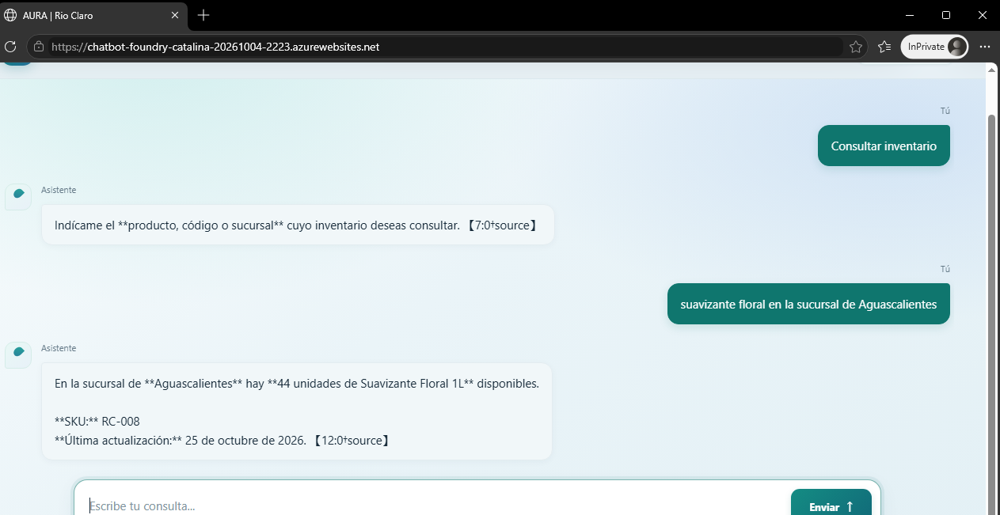
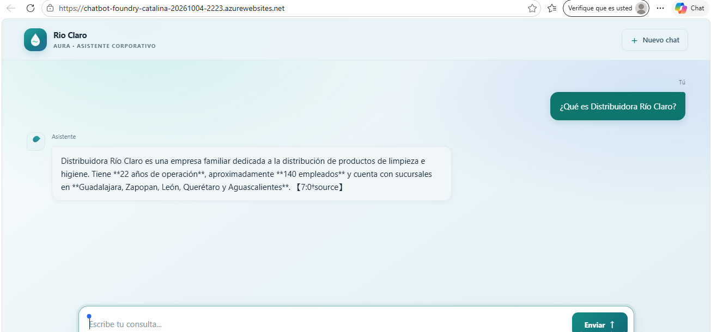
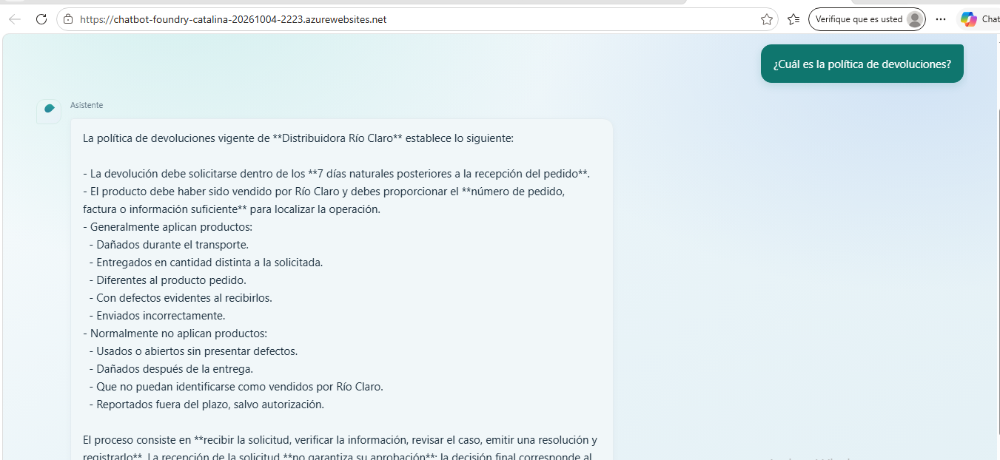
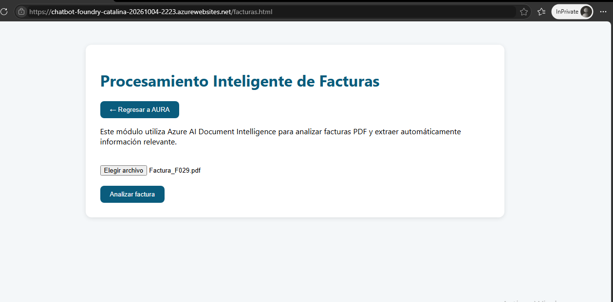
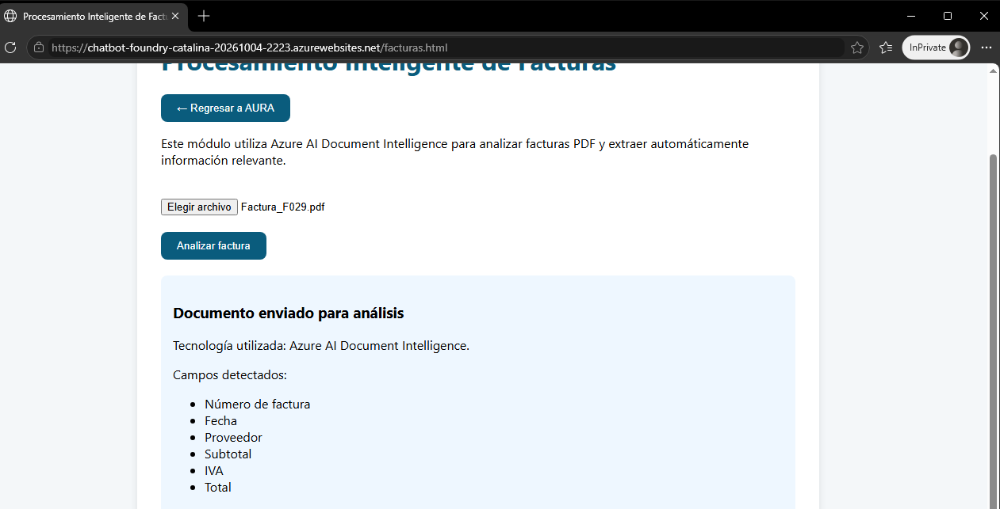
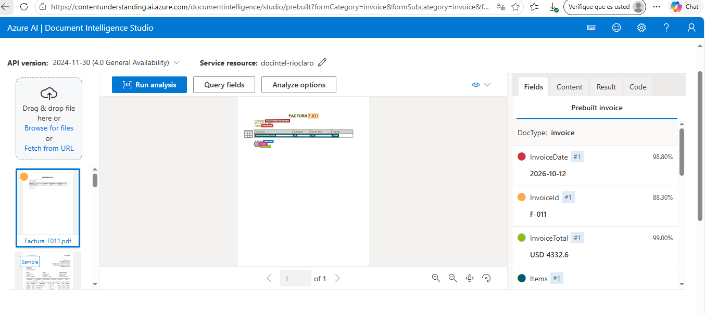

# Río Claro AI — Asistente Inteligente de Operaciones

## Proyecto: De datos dispersos a IA útil

**Empresa:** Distribuidora Río Claro

**Objetivo:** Desarrollar un asistente inteligente que permita consultar información de la empresa de manera rápida y sencilla, utilizando Microsoft Foundry y sus herramientas de inteligencia artificial.

## 1. Problemática

Distribuidora Río Claro enfrenta dificultades para consultar y organizar la información de sus operaciones.

Entre los principales problemas se encuentran:

- La información de productos, inventarios y proveedores está distribuida en distintos archivos.
- El personal necesita invertir tiempo en localizar información para responder preguntas de clientes y empleados.
- Las consultas sobre pedidos y políticas internas pueden tardar en resolverse.
- La empresa necesita mejorar el acceso a la información sin perder la supervisión de las personas.

Estas situaciones dificultan la atención oportuna y hacen necesario contar con una herramienta que facilite la consulta de información empresarial.

## 2. Objetivo

Desarrollar un asistente inteligente para Distribuidora Río Claro que permita al personal consultar información empresarial mediante preguntas en lenguaje natural.

El asistente busca:

- Facilitar la consulta de productos e inventarios.
- Proporcionar información sobre pedidos y proveedores.
- Responder preguntas relacionadas con las políticas y procedimientos de la empresa.
- Reducir el tiempo que el personal dedica a buscar información en diferentes archivos.
- Apoyar la toma de decisiones, manteniendo la supervisión humana.

## 3. Solución desarrollada

Se desarrolló **AURA (Asistente Unificado de Respuestas y Atención)**, un asistente corporativo basado en Azure AI Foundry y Azure OpenAI que permite consultar información empresarial mediante lenguaje natural. 

La solución se presenta mediante una aplicación web que integra dos funcionalidades principales: un asistente corporativo para consultar información de la empresa y un módulo para el procesamiento inteligente de facturas mediante Azure AI Document Intelligence.

Las fuentes de información incorporadas al asistente incluyen:

- Catálogo de productos.
- Inventario de las sucursales.
- Registro de pedidos.
- Información de proveedores.
- Política de devoluciones.
- Preguntas frecuentes de la empresa.

De esta manera, el personal puede consultar información de distintas áreas desde un solo asistente, sin tener que buscar manualmente en cada archivo.

### 3.1. Casos de uso implementados

**Caso de uso 1: Asistente Corporativo AURA**

Permite realizar consultas empresariales mediante una interfaz conversacional. Sus principales funciones son:

- Consulta de inventario.
- Estado de pedidos.
- Información corporativa.
- Consulta de devoluciones y procedimientos.

**Caso de uso 2: Procesamiento Inteligente de Facturas**

Se incorporó un módulo independiente para mostrar el flujo de procesamiento documental de facturas. Sus funcionalidades contempladas son:

- Carga de facturas en formato PDF.
- Análisis documental.
- Identificación de campos clave.
- Simulación del procesamiento de información empresarial.

### 3.2. Arquitectura de la solución

La solución se organiza en dos flujos principales:

**Flujo 1. Asistente corporativo**

Usuario → Aplicación Web AURA → Azure AI Foundry → Azure OpenAI → Base de conocimiento.

**Flujo 2. Procesamiento de facturas**

Usuario → Módulo de Facturas → Azure AI Document Intelligence.

Esta arquitectura permite separar las consultas empresariales del procesamiento documental, manteniendo ambas funcionalidades dentro de una misma solución web.

## 4. Herramientas y tecnologías utilizadas

Para el desarrollo de AURA se utilizaron las siguientes herramientas y servicios:

- **Microsoft Azure:** plataforma de servicios en la nube.
- **Azure AI Foundry:** configuración y administración del agente inteligente.
- **Azure OpenAI:** modelo de inteligencia artificial utilizado para comprender las consultas y generar respuestas.
- **Azure AI Document Intelligence:** servicio utilizado para analizar facturas PDF y extraer información como número de factura, fecha e importe total.
- **Azure App Service:** publicación y alojamiento de la aplicación web.
- **Visual Studio Code:** entorno de desarrollo utilizado para editar y organizar el proyecto.
- **GitHub Copilot:** apoyo en la generación, adaptación y corrección del código.
- **Node.js:** entorno de ejecución de la aplicación web.

La integración de estas herramientas permitió desarrollar una solución que combina inteligencia artificial conversacional y procesamiento documental.

## 5. Pruebas realizadas

Se realizaron pruebas de funcionamiento en la aplicación web AURA para comprobar la interacción con el agente inteligente y el acceso a las diferentes funcionalidades.

Las pruebas del asistente corporativo incluyeron:

Consultas sobre productos e inventario.

Consultas sobre el estado de los pedidos.

Preguntas sobre la empresa.

Consultas sobre la política de devoluciones.

Recuperación de información desde las distintas fuentes de conocimiento.

También se verificó el funcionamiento de la navegación entre la página principal y el módulo de facturas.

El prototipo fue probado localmente y posteriormente publicado como una aplicación web accesible mediante internet.

El módulo de facturas fue validado mediante Azure AI Document Intelligence utilizando el modelo preconfigurado Invoice.

Durante las pruebas se procesaron facturas PDF ficticias, logrando extraer correctamente campos como:

- Invoice ID
- Invoice Date
- Invoice Total

Los resultados obtenidos demostraron la capacidad del servicio para identificar información estructurada contenida en documentos empresariales.

## 6. Uso responsable de la inteligencia artificial

AURA fue diseñado como una herramienta de apoyo para el personal de Distribuidora Río Claro, con el propósito de facilitar el acceso a la información y mejorar la atención, sin sustituir la supervisión ni las decisiones humanas.

Para promover un uso responsable de la inteligencia artificial, se consideran los siguientes principios:

Transparencia: el usuario debe saber que está interactuando con un asistente basado en inteligencia artificial.

Confiabilidad: las respuestas deben fundamentarse en la información disponible en las fuentes de conocimiento.

Honestidad: cuando no exista información suficiente, el asistente debe indicarlo y evitar generar datos no comprobados.

Supervisión humana: las decisiones administrativas y financieras deben permanecer bajo responsabilidad del personal autorizado.

Privacidad: la información empresarial y los datos confidenciales deben manejarse de manera segura.

Apoyo al personal: la inteligencia artificial busca facilitar las actividades de los empleados, no reemplazar su experiencia y criterio.

## 7. Arquitectura y funcionamiento de AURA

La solución está compuesta por una aplicación web que integra dos módulos independientes.

### 7.1. Flujo del asistente corporativo

1. El usuario ingresa a la aplicación web AURA.
2. Selecciona una consulta rápida o escribe una pregunta en el chat.
3. La solicitud se envía al agente configurado en Azure AI Foundry.
4. El agente utiliza Azure OpenAI para interpretar la consulta y generar una respuesta.
5. Cuando es necesario, consulta las fuentes de conocimiento empresariales.
6. La respuesta se presenta al usuario en la aplicación web.

### 7.2. Flujo del módulo de facturas

1. El usuario ingresa al módulo de facturas.
2. Selecciona un documento PDF para cargarlo.
3. La interfaz presenta el flujo de análisis documental.
4. Se utilizó Azure AI Document Intelligence para analizar facturas PDF mediante el modelo preconstruido Invoice.

Durante las pruebas se identificaron correctamente datos relevantes como:

- Número de factura
- Fecha
- Total de la factura

La validación se realizó utilizando documentos PDF de ejemplo y facturas ficticias generadas para el proyecto.

### 7.3. Componentes principales

- Aplicación web AURA.
- Agente de Azure AI Foundry.
- Azure OpenAI.
- Fuentes de conocimiento empresariales.
- Módulo de facturas.
- Azure AI Document Intelligence (validado mediante pruebas de procesamiento documental).

## 8. Acceso al prototipo

El prototipo AURA se encuentra publicado como una aplicación web en Microsoft Azure.

**Enlace de acceso:** https://chatbot-foundry-catalina-20261004-2223.azurewebsites.net

La aplicación permite acceder al asistente corporativo, realizar consultas sobre la información de Distribuidora Río Claro y navegar al módulo de facturas.

## 9. Evidencias del proyecto

Se presentan las evidencias de las pruebas realizadas y de las funcionalidades desarrolladas en AURA.

### 9.1. Página principal de AURA

Evidencia de la interfaz principal del asistente corporativo AURA desplegado en Microsoft Azure App Service.

La página muestra las consultas rápidas disponibles para el usuario, así como el acceso al módulo de procesamiento inteligente de facturas.

### 9.2. Consulta de inventario

Evidencia de una consulta realizada al asistente para obtener información sobre los productos y las existencias de Distribuidora Río Claro.

### 9.3. Información corporativa

Evidencia de una consulta sobre Distribuidora Río Claro, utilizando las fuentes de conocimiento incorporadas al asistente.

### 9.4. Política de devoluciones

Evidencia de una consulta sobre las condiciones y procedimientos de devolución de la empresa.

### 9.5. Módulo de facturas

Evidencia de la interfaz destinada a la carga y consulta de facturas.

### 9.6. Resultado del análisis de factura

Evidencia del resultado mostrado durante la prueba de análisis de una factura.

### 9.7. Azure AI Document Intelligence Studio

Evidencia del entorno de Document Intelligence Studio considerado para el procesamiento inteligente de documentos.

## 10. Resultados obtenidos

La implementación de **AURA** permitió centralizar el acceso a la información empresarial de Distribuidora Río Claro.

Mediante **Azure AI Foundry** y **Azure OpenAI** se logró desarrollar un asistente capaz de responder consultas sobre inventario, pedidos, devoluciones e información corporativa.

Asimismo, **Azure AI Document Intelligence** permitió validar el procesamiento inteligente de facturas mediante la extracción automática de información documental.

El prototipo fue publicado exitosamente en **Azure App Service**, permitiendo el acceso mediante Internet a través de una URL pública.

La solución integra capacidades de inteligencia artificial generativa, búsqueda basada en conocimiento empresarial y procesamiento inteligente de documentos, proporcionando una plataforma inicial para la transformación digital de la organización.

Entre los principales beneficios obtenidos destacan:

- Centralización de la información empresarial.
- Reducción del tiempo de búsqueda de información.
- Acceso simplificado mediante lenguaje natural.
- Validación del uso de inteligencia artificial generativa en escenarios corporativos.
- Incorporación de capacidades de procesamiento inteligente de documentos.
- Publicación de una solución accesible mediante una aplicación web desplegada en Microsoft Azure.

## 11. Conclusiones

El desarrollo de AURA permitió construir un prototipo de asistente corporativo que facilita el acceso a la información de Distribuidora Río Claro mediante consultas en lenguaje natural.

La integración de Azure AI Foundry y Azure OpenAI permitió implementar una solución conversacional capaz de consultar diferentes fuentes de información empresarial desde una aplicación web.

Asimismo, se incorporó un módulo de facturas que amplía las posibilidades de la solución hacia el procesamiento inteligente de documentos, contemplando el uso de Azure AI Document Intelligence.

Este proyecto demuestra cómo las herramientas de inteligencia artificial de Microsoft Azure pueden aplicarse a situaciones reales de una empresa para mejorar el acceso a la información, agilizar consultas y apoyar las actividades operativas.

AURA representa una primera etapa de transformación digital para Distribuidora Río Claro, con posibilidades de crecimiento mediante nuevas integraciones y funcionalidades.

La solución desarrollada demuestra que las capacidades de Inteligencia Artificial de Microsoft Azure pueden utilizarse para resolver problemas empresariales reales relacionados con acceso a la información, automatización documental y apoyo operativo.

La arquitectura implementada constituye una base escalable para futuras iniciativas de transformación digital dentro de Distribuidora Río Claro.